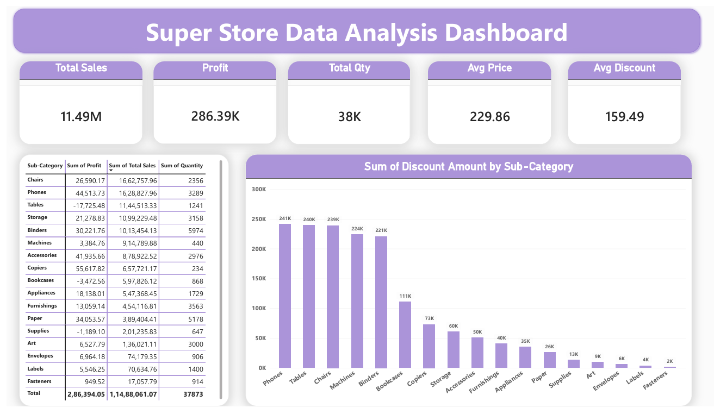
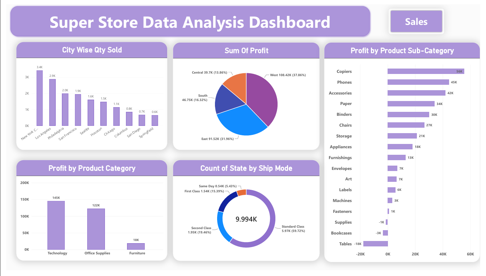

# 📊 Super Store Data Analysis Dashboard | Power BI

## 📌 Project Overview

An interactive Power BI dashboard developed to analyze Super Store sales performance, profitability, product categories, shipping methods, and discount patterns.

The project transforms sales data into meaningful business insights through interactive visualizations and KPI tracking.

## 🎯 Project Objectives

- Analyze overall sales and profit performance.
- Identify top-performing cities and product sub-categories.
- Compare profitability across product categories.
- Understand shipping mode distribution.
- Analyze discount patterns across sub-categories.
- Present business insights through interactive dashboards.

## 🛠️ Tools & Technologies

- Microsoft Power BI
- Power Query
- DAX
- Data Cleaning & Transformation
- Data Visualization

## 📊 Dashboard Pages

### Page 1 – Sales Analysis
- City-wise quantity sold
- Profit by region
- Profit by sub-category
- Profit by category
- Shipping mode distribution

### Page 2 – Dashboard Overview
- Total Sales
- Total Profit
- Total Quantity
- Average Price
- Average Discount
- Sub-category performance table
- Discount amount by sub-category

## 📈 Key Performance Indicators (KPIs)

| **KPI Metric** --- **Dashboard Value** |

| 💰 Total Sales -------------|11.49M|
| 📊 Total Profit ---- -------|286.39K|
| 📦 Total Quantity Sold -----| 38K |
| 🏷️ Average Price -----------|229.86|
| 🎯 Average Discount --------|159.49|

## 🖼️ Dashboard Screenshots
### Sales Analysis

### Dashboard Overview

## 💡 Business Analysis

The dashboard helps explore:

- Which cities contribute the highest quantity sold?
- Which regions generate the most profit?
- Which sub-categories perform well or generate losses?
- How are orders distributed across shipping modes?
- Which sub-categories have higher discount amounts?

## 📁 Project Files

- `SuperStoreDashboard.pbix` – Power BI report
- `Sales_Analysis.png` – Sales analysis screenshot
- `Dashboard_Overview.png` – Dashboard overview screenshot

## 🚀 Conclusion

This project demonstrates the use of Power BI, Power Query, and DAX to transform sales data into interactive dashboards and support data-driven business analysis.

**Project Type:** Data Analytics  
**Tool:** Microsoft Power BI
